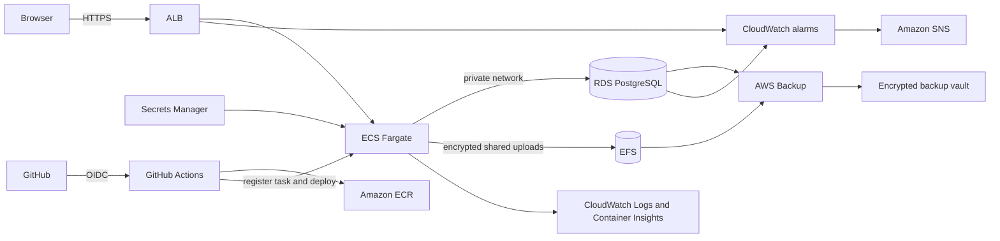

# TaskFlow Architecture

## Runtime

- Flask application factory serves the API and static dashboard.
- SQLAlchemy persists users, tasks, employees, notifications, pipelines, comments, activity, attachments, and security records.
- Server-Sent Events pushes notification changes; five-second polling provides a fallback.
- Gunicorn runs the production container with threaded workers as a non-root user.
- Production deployment uses ECS Fargate, private PostgreSQL, encrypted EFS for shared uploads, and Secrets Manager for the session key and restricted database credentials.

## Delivery flow

## Security boundaries

- HTTP-only same-site sessions protect authenticated API routes.
- Admin-only role management and database backup endpoints return `403` for other roles.
- Task and attachment access is scoped to the logged-in owner.
- Password reset tokens expire after 30 minutes.
- TOTP setup and verification are available for authenticator-app based 2FA.
- In AWS, HTTP redirects to HTTPS; only the ALB accepts public inbound traffic, and task security groups permit inbound traffic only from that ALB.
- PostgreSQL and EFS mount targets are private. The application receives a dedicated database role instead of the RDS administrator credentials.
- Secrets, database storage, shared uploads, and AWS Backup recovery points are encrypted. Daily recovery points are retained for 35 days.
- GitHub deployment uses a branch-restricted OIDC role instead of static AWS access keys. See [docs/aws-deployment.md](aws-deployment.md) for deployment and recovery steps.
