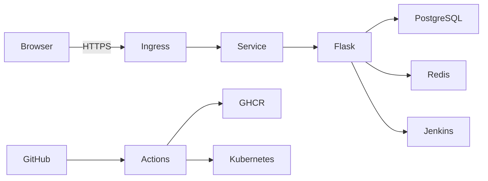

# TaskFlow Architecture

## Runtime

- Flask application factory serves the API and static dashboard.
- SQLAlchemy persists users, tasks, employees, notifications, pipelines, comments, activity, attachments, and security records.
- Server-Sent Events pushes notification changes; five-second polling provides a fallback.
- Gunicorn runs the production container with threaded workers.

## Delivery flow

## Security boundaries

- HTTP-only same-site sessions protect authenticated API routes.
- Admin-only role management and database backup endpoints return `403` for other roles.
- Task and attachment access is scoped to the logged-in owner.
- Password reset tokens expire after 30 minutes.
- TOTP setup and verification are available for authenticator-app based 2FA.
